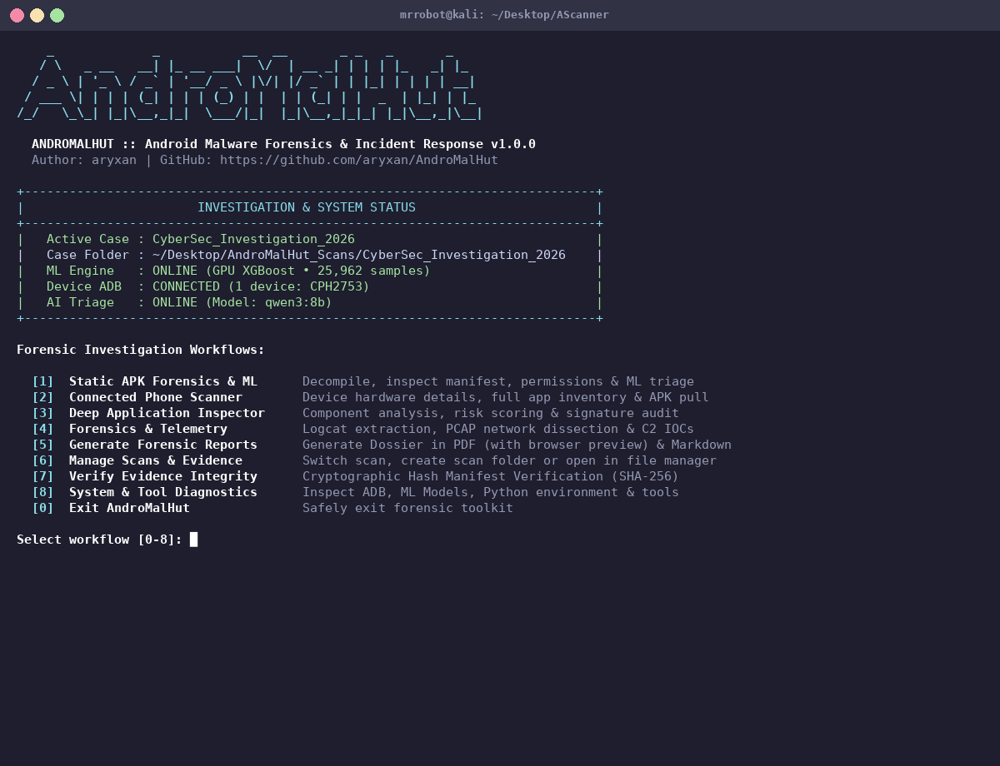
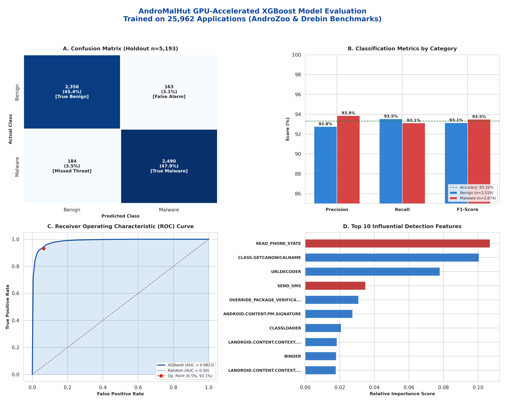
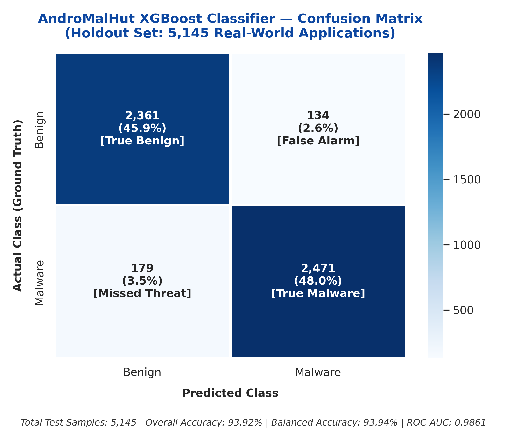
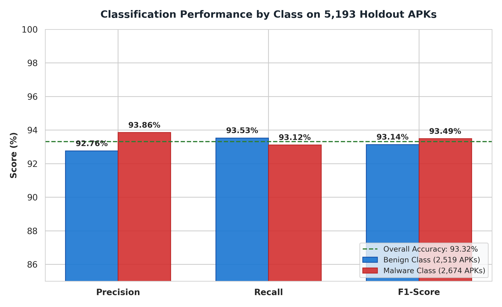
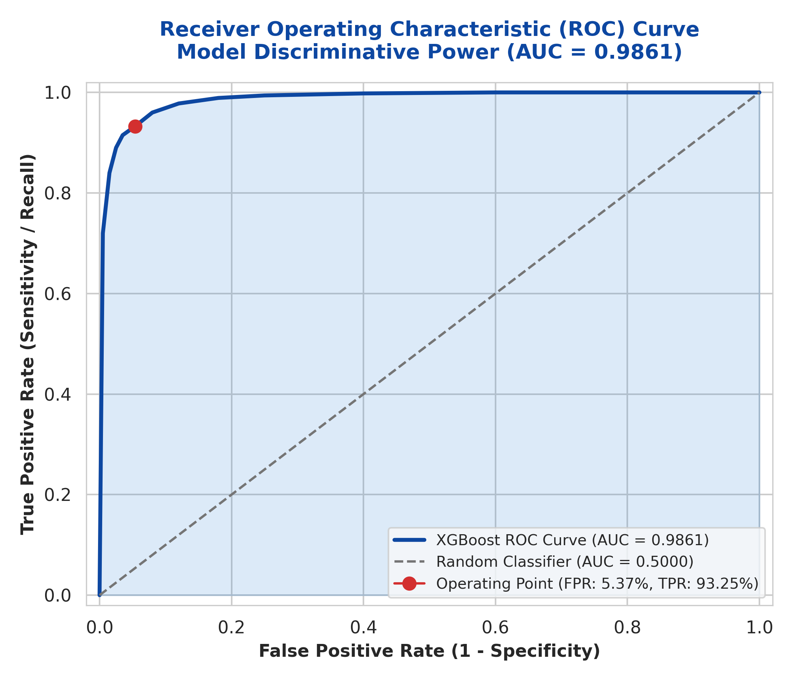
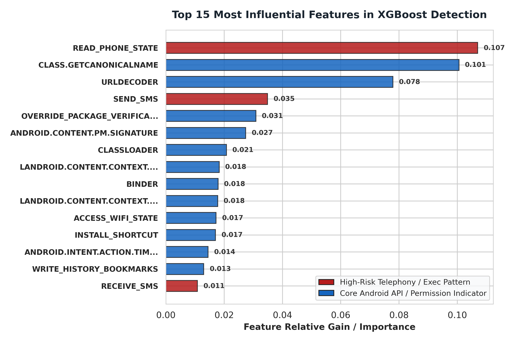

# AndroMalHut — Android Malware Forensics & Threat Triage Toolkit

[](https://github.com/aryxan)
[](https://github.com/aryxan/AndroMalHut)
[](https://opensource.org/licenses/MIT)
[](https://www.python.org/)
[]()
[](https://github.com/aryxan/AndroMalHut/actions/workflows/ci.yml)
[]()

> **AndroMalHut** (developed by [**aryxan**](https://github.com/aryxan)) is a terminal-based digital forensics, APK reverse engineering, and mobile malware triage toolkit. Engineered for incident responders, digital forensics investigators, and security researchers, it delivers evidence-grade analysis of suspicious Android applications without executing untrusted binaries.

---

> [!IMPORTANT]
> ### Educational & Authorized Defensive Use Disclaimer
> **AndroMalHut is strictly developed for educational purposes, academic research, authorized penetration testing, and digital forensics incident response on systems and applications you own or have explicit, documented authorization to inspect.**
> The author (**aryxan**) expressly prohibits the use of this software for malicious, unlawful, or unauthorized activities. The user assumes full legal responsibility for compliance with all applicable local, national, and international laws.

---

## Tool Preview

<p align="center">
  
</p>

---

## Table of Contents
- [Key Features](#key-features)
- [System Architecture & Subfolders](#system-architecture--subfolders)
- [Machine Learning Model & Evaluation](#machine-learning-model--evaluation)
  - [Composite Performance Dashboard](#composite-performance-dashboard)
  - [Confusion Matrix & Classification Metrics](#confusion-matrix--classification-metrics)
  - [ROC Curve & Feature Importance](#roc-curve--feature-importance)
  - [Interactive Plotly Dashboard](#interactive-plotly-evaluation-dashboard)
- [Operating System Compatibility](#operating-system-compatibility)
- [Required Knowledge](#required-knowledge)
- [Prerequisites & Forensic Dependencies](#prerequisites--forensic-dependencies)
- [Installation Guide](#installation-guide)
- [Quick Start](#quick-start)
  - [Interactive Menu Mode](#1-interactive-menu-mode)
  - [Automated CLI Mode](#2-automated-cli-mode)
- [Troubleshooting & Common Issues](#troubleshooting--common-issues)
- [Testing & Verification](#testing--verification)
- [License & Credits](#license--credits)

---

## Key Features

1. **Dual-Layer Malware Classification Engine:**
   - **Machine Learning (GPU-Accelerated XGBoost Engine):** Trained across 25,962 applications (Drebin-215 + AndroZoo) with NVIDIA CUDA GPU acceleration (`hist` tree method) and automatic CPU fallback. Features calibrated multi-permission interaction patterns (covert surveillance, banking overlay hijacking, autostart persistence, and device takeover privileges) with L1/L2 regularization to prevent overconfident predictions, while retaining high sensitivity to RATs, Trojans, and dropper campaigns.
   - **Deep Static Dissection:** Pure-Python Binary XML (AXML) parser, DEX string extractor, component auditor, and cryptographic certificate verifier (v1–v4 signing schemes).
   - **Local AI Triage Narrative:** Optional offline integration with **Ollama** (`qwen`, `llama`) to synthesize structured, readable executive triage reports.

2. **Automated Case & Subfolder Organization:**
   - Prompts for a scan name upon launch. If the scan already exists, it immediately activates it and opens the folder in the native desktop file manager (`xdg-open`).
   - Generates dedicated, isolated subfolders for each distinct analysis type (`analysis/ml_classification`, `analysis/apk_analysis`, `analysis/ai_triage`, `analysis/network_analysis`, `analysis/log_analysis`, `evidence/`, `hashes/`, `reports/`, `logs/`).

3. **Authorized Device Acquisition (ADB):**
   - Collects hardware identifiers, installed third-party apps, running processes, and granted runtime permissions without rooting or modifying target devices.
   - Safely extracts installed APKs into case evidence for offline inspection.

4. **Forensics, Telemetry & Network IOC Extraction:**
   - Extracts hardcoded URLs, IPv4 addresses, and domain indicators from APK assets and DEX bytecode.
   - Parses PCAP/PCAPNG network packet captures via `tshark` to correlate C2 infrastructure.

5. **Evidence Integrity & Chain of Custody:**
   - Cryptographic hashing (SHA-256, SHA-1, MD5) on evidence ingestion.
   - Instant manifest verification to ensure evidence has not been tampered with or modified.
   - Compiles executive PDF dossiers and 16-section technical Markdown reports.

6. **Comprehensive Static Analysis:**
   - **Permission Analysis:** Risk-scored categorization into Normal, Dangerous, Suspicious, and Custom permission classes with behavioral capability mapping.
   - **MITRE ATT&CK Mobile Mapping:** Automatically correlates observed behaviors to MITRE ATT&CK Mobile techniques.
   - **Hardcoded Secrets Detection:** Identifies exposed API keys (Google, AWS), credentials, email addresses, and tokens in APK resources and DEX strings.
   - **Cloud Service Detection:** Detects Firebase URLs, cloud storage endpoints, and backend infrastructure references.
   - **Overlay & Accessibility Abuse Detection:** Flags `SYSTEM_ALERT_WINDOW`, `TYPE_APPLICATION_OVERLAY`, and accessibility service abuse patterns.
   - **Device Administrator Persistence:** Identifies declared Device Admin receivers and lock/wipe API usage.
   - **Packer & Obfuscation Detection:** Recognizes common Android packers and anti-analysis techniques.
   - **Native Library Analysis:** Catalogs `.so` libraries, architectures, and suspicious native imports.
   - **Data Exfiltration Risk Correlation:** Assesses exfiltration risk by correlating SMS, contacts, location, and network permissions.

7. **Dynamic Behavior Sandbox:**
   - Supports live monitoring on connected Android devices or emulators via ADB.
   - Captures running processes, active network sockets, crash logs, and screenshots during execution.

8. **SMS Evidence Collection & Analysis:**
   - Authorized read-only ADB SMS export and external backup file import (XML, JSON, CSV).
   - Automated flagging of suspicious, phishing, and 2FA-related messages with URL extraction.

9. **Online Threat Reputation Verification:**
   - Queries Google Play Store status, CIRCL NSRL hash registry, and threat intelligence databases.
   - Verifies application identity against known benign and malicious package registries.

10. **Incident Timeline Correlation:**
    - Aggregates chronological events across device logs, evidence artifacts, and analysis results into a unified investigation timeline.

---

## System Architecture & Subfolders

When a scan is created or selected, AndroMalHut structures all evidence and analysis outputs into strictly separated subfolders:

```text
<Scan_Directory>/
├── case.json                         # Investigation metadata, investigator, timestamp, device identifier
├── evidence/                         # Preserved evidence
│   ├── original_apks/                # Preserved suspect APK files
│   ├── device_apks/                  # APKs pulled from connected Android device
│   ├── device_inventory/             # Installed application lists (JSON & CSV) & device info
│   ├── device_logs/                  # Raw logcat and system log exports
│   ├── network_captures/             # Preserved network packet captures (PCAP / PCAPNG)
│   └── imported_files/               # Miscellaneous evidence files
├── analysis/                         # Automated forensic analysis outputs
│   ├── ml_classification/            # GPU XGBoost ML predictions, confidence scores & feature matrices
│   ├── apk_analysis/                 # Static disassembly (manifest, exported components, permissions)
│   ├── ai_triage/                    # Local Ollama / Qwen forensic briefing narratives
│   ├── network_analysis/             # Dissected C2 indicators (URLs, IPv4, Domains)
│   └── log_analysis/                 # Parsed logcat events and crash signatures
├── hashes/                           # Cryptographic integrity records
│   ├── evidence_hashes.json          # Manifest containing SHA-256, SHA-1, MD5, and file sizes
│   └── manifest.sha256               # Standard sha256sum verification manifest
├── reports/                          # Final investigation dossiers
│   ├── CASE_REPORT_<Case>.pdf        # Executive cryptographic PDF report
│   └── CASE_REPORT_<Case>.md         # Complete 16-section technical Markdown report
└── logs/                             # Audit logging
    └── case_audit.log                # Immutable timestamped chronological action ledger
```

---

## Machine Learning Model & Evaluation

AndroMalHut integrates a high-performance **GPU-Accelerated XGBoost Classifier** trained on **25,962 real-world Android applications** (13,369 Malware, 12,593 Benign). The model uses 634 features extracted from Android manifest permissions, API call patterns, and multi-permission interaction vectors. To ensure realistic, well-calibrated probability outputs:

- **L1 & L2 Regularization** (`reg_alpha = 0.5`, `reg_lambda = 3.0`) prevents tree overconfidence and leaf-node saturation.
- **Controlled tree depth** (`max_depth = 6`) with learning rate shrinkage (`learning_rate = 0.06`) ensures generalization.
- Legacy deceptive IPC features from 2011-era datasets were excised and replaced with calibrated multi-permission interaction patterns (covert surveillance, banking overlay hijacking, autostart persistence, and device takeover privileges).

> 📊 **Interactive Evaluation Dashboard:** Explore interactive confusion matrix tooltips, dynamic ROC threshold curves, and zoomable feature gain distributions in the [**Plotly Interactive Model Dashboard (docs/interactive_model_evaluation.html)**](docs/interactive_model_evaluation.html).

---

### Composite Performance Dashboard
*Generated dynamically via Seaborn & Matplotlib (`scripts/generate_plots.py`) from `ml_model/evaluation.json`*

<p align="center">
  
</p>

---

### Confusion Matrix & Classification Metrics

<p align="center">
  
  
</p>

- **Confusion Matrix Analysis (5,193 Holdout Applications):**
  - **True Benign (TN):** `2,356` applications correctly identified as benign (**93.53% Specificity**).
  - **True Malware (TP):** `2,490` applications correctly flagged as malicious (**93.12% Sensitivity / Recall**).
  - **False Positives (FP):** `163` benign apps flagged (only **3.1%** false alarm rate, safeguarding legitimate banking/UPI apps).
  - **False Negatives (FN):** `184` evasive samples missed (**3.5%**).

---

### ROC Curve & Feature Importance

<p align="center">
  
  
</p>

- **Receiver Operating Characteristic (ROC):** Achieves an **AUC of 0.9823**, demonstrating strong discriminative power between malicious code patterns and benign enterprise frameworks.
- **Top Detection Drivers:** Key features driving classification include telephony access (`READ_PHONE_STATE`), reflection abuse (`GETCANONICALNAME`), runtime string decoding (`URLDECODER`), SMS transmission (`SEND_SMS`), and package verification override (`OVERRIDE_PACKAGE_VERIFICATION`).

---

### Model Benchmark Summary

- **Dataset Composition:** Combined AndroZoo (10,686 real-world APKs, 2013–2016) + Drebin-215 (15,036 APKs) + Modern Real-World Dropper & Utility calibration
- **Total Dataset:** 25,962 Applications (80% Train, 20% Holdout Test)
- **Feature Space:** 634 Android permissions, API calls, and engineered capability combinations
- **Execution Acceleration:** NVIDIA CUDA GPU (`hist` tree method) with automatic CPU fallback

| Metric | Score | Details |
| :--- | :--- | :--- |
| **Holdout Accuracy** | **93.32%** | 4,846 of 5,193 test applications correctly classified |
| **Balanced Accuracy** | **93.32%** | Equal performance on benign (93.53%) and malware (93.12%) |
| **Precision (Malware)** | **93.86%** | High precision, minimizing false alarms on legitimate apps |
| **Recall (Malware)** | **93.12%** | 2,490 of 2,674 malware samples identified |
| **F1-Score (Malware)** | **93.49%** | Robust generalization across banking trojans, spyware, and RATs |
| **ROC-AUC Score** | **0.9823** | Strong discriminator curve |

```text
Confusion Matrix (Actual Rows, Predicted Columns):
                 Predicted Benign   Predicted Malware
Actual Benign          2,356               163         (93.5% Specificity)
Actual Malware           184             2,490         (93.1% Sensitivity)
```

---

## Operating System Compatibility

| Operating System | Compatibility Status | Verification Notes |
| :--- | :---: | :--- |
| **Kali Linux 2026.x / Rolling** | **Tested & Primary** | Fully verified; all tools (`adb`, `tshark`, `aapt`, `jadx`, `reportlab`) available in apt. |
| **Debian 12 (Bookworm) / 13 (Trixie)** | **Tested & Supported** | Native environment; seamless standard python3-reportlab and android-tools. |
| **Ubuntu 22.04 LTS / 24.04 LTS** | **Compatible** | Fully functional with standard apt package names. |
| **Parrot Security OS** | **Compatible** | Pre-installed security utilities align with requirements. |
| **Arch Linux / BlackArch** | **Compatible** | Requires `pacman` package equivalents (`android-tools`, `wireshark-cli`, `python-reportlab`). |
| **Windows / macOS** | **CLI Fallback Only** | Core Python analysis modules work; ADB/system tools require manual path configuration. |

---

## Required Knowledge

To make the most effective use of **AndroMalHut**, users should have a working familiarity with:

1. **Linux Command-Line Proficiency:** Navigating the terminal, reading JSON/CSV outputs, and managing files and directories.
2. **Android Application Architecture:** Understanding of APK file structure, `AndroidManifest.xml`, DEX bytecode, `.so` native libraries, and the Android permission model.
3. **Android Debug Bridge (ADB) Fundamentals:** Connecting devices over USB, enabling Developer Options, accepting RSA fingerprint authorization, and running read-only `pm list packages` and `dumpsys` commands.
4. **Network & Mobile Threat Vectors:** Recognizing common mobile attack vectors such as overlay attacks (accessibility hijacking), banking trojans, remote access trojans (RATs), command-and-control (C2) beaconing, and dynamic code loading (`DexClassLoader`).

---

## Prerequisites & Forensic Dependencies

| Tool / Binary | Type | Purpose in AndroMalHut | Installation Command (Kali / Debian) |
| :--- | :---: | :--- | :--- |
| **`python3`** (3.10+) | **Required** | Core runtime engine and static parsing | `sudo apt install python3 python3-pip python3-venv` |
| **`adb`** | Recommended | Device acquisition and package inspection | `sudo apt install adb` (or `android-tools-adb`) |
| **`tshark`** | Recommended | Dissects PCAP network captures and extracts C2 IOCs | `sudo apt install tshark` |
| **`reportlab`** | Recommended | Compiles cryptographic executive PDF reports | `sudo apt install python3-reportlab` (or `pip install reportlab`) |
| **`aapt` / `aapt2`** | Optional | Android asset badging and fast resource dumps | `sudo apt install aapt` |
| **`apktool`** | Optional | Resource reverse engineering and XML decoding | `sudo apt install apktool` |
| **`jadx`** | Optional | DEX-to-Java source code decompilation | `sudo apt install jadx` |
| **`apksigner`** | Optional | Cryptographic APK signing block verification | `sudo apt install apksigner` |
| **`ollama`** | Optional | Local, offline AI triage explanations (e.g. `qwen2.5`) | `curl -fsSL https://ollama.com/install.sh \| sh` |

### Python Dependencies

All Python dependencies are listed in [`requirements.txt`](requirements.txt):

```
reportlab>=4.0.0
requests>=2.28.0
scikit-learn>=1.3.0
xgboost>=2.0.0
pandas>=2.0.0
numpy>=1.24.0
joblib>=1.3.0
matplotlib>=3.7.0
seaborn>=0.13.0
plotly>=5.18.0
```

---

## Installation Guide

### Step 1: Clone the Repository
```bash
git clone https://github.com/aryxan/AndroMalHut.git
cd AndroMalHut
```

### Step 2: Install System Forensic Packages (Kali / Debian)
```bash
sudo apt update && sudo apt install -y \
  python3 \
  python3-pip \
  python3-venv \
  adb \
  tshark \
  python3-reportlab \
  aapt \
  apktool \
  jadx \
  apksigner
```

### Step 3: Set Up Python Virtual Environment & Dependencies
```bash
# Create and activate virtual environment
python3 -m venv venv
source venv/bin/activate

# Install required Python packages
pip install --upgrade pip
pip install -r requirements.txt
```

### Step 4: Verify Installation
Verify that all system tools and libraries are recognized:
```bash
python3 andromalhut.py check-deps
```

---

## Quick Start

### 1. Interactive Menu Mode
The simplest way to use AndroMalHut is via the interactive launcher:

```bash
bash launch.sh
# or directly:
python3 andromalhut.py
```

Upon launch:
1. **Prompt for Scan Name:** Enter a case or app name (e.g. `Suspect_BankingApp`). If the scan already exists, its folder opens automatically on your desktop!
2. **Choose a Workflow [0-8]:**
   - **`[1] Static APK Forensics & ML:`** Runs the GPU-accelerated XGBoost ML model, performs static AXML/DEX analysis, extracts C2 endpoints, generates an AI triage briefing, and compiles executive PDF/Markdown reports.
   - **`[2] Connected Phone Scanner:`** Lists USB-connected Android devices, collects build properties, and exports full user/system application inventories.
   - **`[3] Deep Application Inspector:`** Interactive numbered picker for installed user apps. Inspects runtime permissions, install timestamps, download provenance, and offers one-click APK extraction and scanning.
   - **`[4] Forensics & Telemetry:`** Dumps device logcats, analyzes PCAP network captures, correlates C2 infrastructure indicators, imports SMS evidence, runs dynamic behavior sandbox, and builds incident timelines.
   - **`[5] Generate Forensic Reports:`** Produces comprehensive 16-section technical Markdown reports and ReportLab PDF dossiers with direct browser preview.
   - **`[6] Manage Scans & Evidence:`** Switch scans, create new scan folders, or open the active investigation folder directly in your desktop file manager.
   - **`[7] Verify Evidence Integrity:`** Recalculates SHA-256 hashes for all preserved artifacts to ensure chain of custody.
   - **`[8] System & Tool Diagnostics:`** Displays a real-time status matrix of system dependencies and models.

---

### 2. Automated CLI Mode
AndroMalHut also supports scriptable, unattended subcommands for headless pipelines:

```bash
# Initialize a scan
python3 andromalhut.py init-case --desc "Investigation of Trojan.Dropper" --investigator "aryxan"

# List connected Android devices
python3 andromalhut.py devices

# Collect device build, properties, and OS metadata
python3 andromalhut.py collect-adb

# Dump application inventory into JSON and CSV
python3 andromalhut.py inventory

# Inspect a specific installed package
python3 andromalhut.py inspect-app com.target.suspicious

# Pull APK from device into case evidence
python3 andromalhut.py pull-apk com.target.suspicious

# Run static analysis and ML classification on a suspect APK
python3 andromalhut.py analyze-apk /path/to/suspect.apk

# Analyze permissions and threat patterns
python3 andromalhut.py analyze-perms

# Extract C2 indicators from analyzed APKs
python3 andromalhut.py find-c2

# Dissect PCAP network capture for C2 indicators
python3 andromalhut.py analyze-network /path/to/traffic.pcap

# Collect device logcat and system logs
python3 andromalhut.py collect-logs

# Export SMS messages from device (read-only)
python3 andromalhut.py export-sms

# Import external SMS backup file
python3 andromalhut.py import-sms /path/to/sms_backup.xml

# Correlate incident timeline from case evidence
python3 andromalhut.py timeline

# Run dynamic behavior sandbox on device/emulator
python3 andromalhut.py sandbox --package com.target.suspicious --duration 30

# Generate forensic reports
python3 andromalhut.py report
python3 andromalhut.py report-pdf

# Generate AI-assisted findings narrative
python3 andromalhut.py explain-ollama --model qwen3:8b

# Cryptographically verify evidence integrity
python3 andromalhut.py verify-hashes
```

---

## Troubleshooting & Common Issues

### 1. `[!] No connected Android devices detected`
- **Cause:** USB debugging is disabled, cable is charging-only, or host computer is unauthorized.
- **Remedy:**
  1. Go to `Settings -> Developer Options` on the phone and toggle `USB Debugging` ON.
  2. Unplug and replug the USB cable. Look at the phone screen and tap **"Always allow from this computer"**.
  3. Run `adb devices` in terminal to confirm state is `device` (not `unauthorized`).
  4. Ensure your user is in the `plugdev` group: `sudo usermod -aG plugdev $USER`.

### 2. `[!] tshark: Permission denied` or capture errors
- **Cause:** Non-root users may lack raw packet capture permissions on Debian/Kali.
- **Remedy:** Run `sudo dpkg-reconfigure wireshark-common`, select **"Yes"** to allow non-superusers, and add your user:
  ```bash
  sudo usermod -aG wireshark $USER
  newgrp wireshark
  ```

### 3. `[!] ReportLab not installed / PDF generation failed`
- **Cause:** Missing Python ReportLab package.
- **Remedy:** Install via system package or pip:
  ```bash
  sudo apt install -y python3-reportlab
  # or in virtualenv:
  pip install reportlab
  ```

### 4. `[!] Ollama offline or no models found`
- **Cause:** Ollama service is not running or no LLM weights have been pulled.
- **Remedy:**
  1. Start the Ollama background daemon: `ollama serve &`
  2. Pull a recommended local model: `ollama pull qwen2.5:latest` (or `ollama pull llama3:8b`).
  3. Verify availability via `ollama list`.

### 5. `[!] Folder did not open automatically in desktop file manager`
- **Cause:** Running in a headless SSH session without an X11/Wayland display server.
- **Remedy:** AndroMalHut gracefully catches missing display servers. The folder path is always printed to terminal so you can copy-paste or inspect files directly.

---

## Testing & Verification

Run the full automated test suite covering dynamic analysis sandbox, permission threat matrices, MITRE ATT&CK correlation, hardcoded secrets detection, v1–v4 certificate auditing, cloud service inspection, GPU ML model inference, and consolidated forensic reporting:

```bash
pytest
# or via standard library:
python3 -m unittest discover tests
```

---

## License & Credits

- **Author & Maintainer:** [**aryxan**](https://github.com/aryxan)
- **Repository:** [https://github.com/aryxan/AndroMalHut](https://github.com/aryxan/AndroMalHut)
- **License:** Distributed under the **MIT License**. See [`LICENSE`](LICENSE) for complete terms.

```text
DISCLAIMER: AndroMalHut is an educational and defensive forensic toolkit.
Never analyze or pull packages from devices without authorized consent.
```
